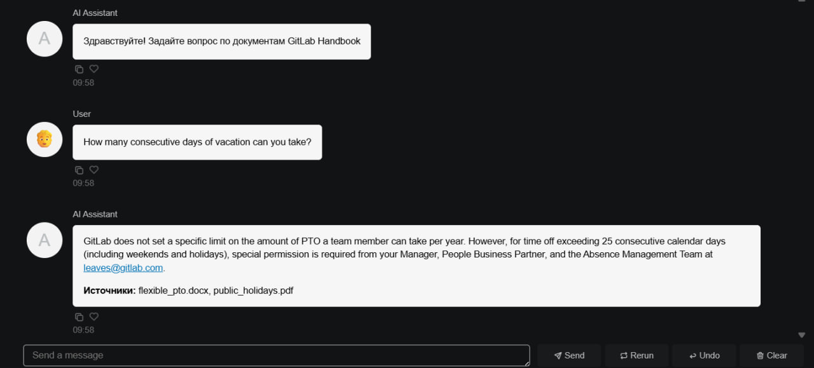
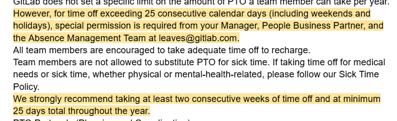

# RAG GitLab Handbook

A RAG AI assistant that answers questions about internal company documents (txt, docx, pdf)
and shows the source files for each answer.
Data: excerpts from the open [GitLab Handbook](https://handbook.gitlab.com).

## Demo

**Assistant answer** (the answer lists its source files):



**Check against the source document** (the highlighted text confirms the answer):



## How it works

1. **Load** documents of different formats from `data/`
2. **Split** them into chunks (800 characters, 100 overlap)
3. **Embed** chunks with Gemini embeddings and store them in a Chroma vector database
4. **Retrieve** the 4 most relevant chunks for each question
5. **Generate** an answer with Gemini using only the retrieved context, with conversation memory
6. **Chat UI** built with Panel, each answer lists its source files

Only the retrieved chunks are sent to the LLM, not the whole document set.
The assistant understands questions in English and Russian.

## Tech stack

Python, LangChain, Gemini API (LLM and embeddings), Chroma, Panel

## Project structure

```
RAG_gitlab-handbook/
├── data/                       
│   ├── flexible_pto.docx
│   ├── public_holidays.pdf
│   ├── support_time_off.txt
│   └── expense_policy.txt
├── eval/
│   └── questions.json           
├── assets/                     
├── rag_gitlab_handbook.ipynb   
├── requirements.txt
├── .env.example                
└── README.md
```

To run the project, copy `.env.example` to `.env`, add a free Gemini API key
from [Google AI Studio] and run the notebook from top to bottom.

## Documents

| File | Format | Topic |
|---|---|---|
| flexible_pto.docx | docx | Flexible PTO policy |
| public_holidays.pdf | pdf | Public holidays and FAQ |
| support_time_off.txt | txt | Support team time off |
| expense_policy.txt | txt | Expense policy |

Source: [GitLab Handbook](https://handbook.gitlab.com). Check the handbook license before reusing the texts.

## Updating documents

Add a new file to `data/` and re-run the notebook: only new files are added to the database.
If you edit an existing file, delete its old chunks (or the `chroma_db/` folder) and re-run.

## Evaluation

The notebook runs test questions from `eval/questions.json` (English and Russian,
including a question with no answer in the documents) and prints the answer,
the expected answer and the retrieved sources for manual review.

## Limitations

- The free Gemini tier has low daily request limits, and model names change over time
- Listed sources include all retrieved chunks, not only the ones used in the answer
- The answer language may follow the prompt language rather than the question language
- Small document set (4 files), built for learning

## Next steps

- Automatic scoring of test answers
- Tools for an agent (e.g. PTO calculator)